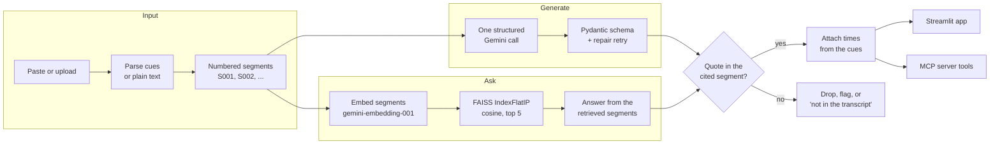

# Podcast Compass

[](https://github.com/KsKarim7/Podcast-Compass/actions/workflows/ci.yml)

Podcast Compass turns a podcast transcript into something you can study from: a summary
with the main themes, a set of key takeaways, navigable chapters, and a short quiz with
answers. The thing it tries to do better than a plain summariser is let you check it —
every takeaway, chapter and quiz answer cites the part of the transcript it came from, and
quotes a few words from it, and the app verifies that quote really appears there before
showing it to you. I built it for people who want to revisit a long episode rather than
re-listen to it: students working through interview or lecture-style shows, and anyone who
remembers that something was said and needs to find where.

## Try it

**<https://podcast-compass.streamlit.app>**

The app sleeps after 12 hours without traffic. If you get a sleep screen, click
**"Yes, get this app back up!"** and give it about a minute.

Demo video: https://drive.google.com/file/d/1oaqHNuqFGtQovVtEgqFXXG5d2dyzZEjb/view?usp=sharing

## How to use it in 30 seconds

1. Click **Load example episode**. You get a full result immediately, generated earlier and
   stored in the repository, so it costs no API call and works even if the daily limit is
   spent.
2. To use your own, paste a transcript or upload a `.txt`, `.vtt` or `.srt` file, then click
   **Generate** once.
3. Answer the quiz and press **Check answers**. Each question shows whether you were right,
   why, and the quote it came from.
4. Under **Ask the podcast**, type a question and press **Ask**. The answer comes only from
   the parts of the transcript that match it, with the quotes it relies on, each checked
   against the transcript. If no quote survives, it says the transcript does not answer it.
5. Pick a section under **Revise one section**, choose something like *Shorter* or *Harder
   questions*, and press **Revise this section**. Only that section is regenerated; the
   rest stays exactly as it was.
6. **Undo last change** puts the previous version back. It makes no API call.
7. **Copy or download** gives you the whole result as Markdown or JSON. The copy button is
   in the top-right of the text box.

## Supported inputs and limits

| | |
|---|---|
| Formats | Pasted text, `.txt`, `.vtt`, `.srt` |
| Minimum | 250 words |
| Maximum | 150,000 characters, or 2 MB per file |
| Per session | 10 generations, revisions or questions, with 4 seconds between them |
| Per day | 400 requests, shared by everyone using the app |

The format is detected from the content rather than the file extension, so a `.txt` file
containing subtitle markup is still read as subtitles.

**Timestamps only come from `.vtt` and `.srt` files.** They are read from the subtitle cues
by the app, never produced by the model. Plain text gets chapters with titles and no times,
and the app says so rather than inventing them.

The 250-word minimum exists because chapters have to start at increasing points in the
transcript, so a very short paste cannot produce more than one chapter. Rejecting it up
front is better than spending a request to find out.

## How it works



Every path ends at the same check: an item is shown only if it cites a segment and quotes
text that really appears in it, and times are attached by the app from the subtitle cues.
The model never writes a timestamp. The design decisions behind this are in
[docs/ENGINEERING.md](docs/ENGINEERING.md).

## Run it locally

You need Python 3.11 or newer and a Gemini API key from
[Google AI Studio](https://aistudio.google.com/apikey). The free tier is enough.

### Windows, PowerShell

```powershell
git clone https://github.com/KsKarim7/Podcast-Compass.git
cd Podcast-Compass
python -m venv .venv
.\.venv\Scripts\python.exe -m pip install -r requirements-dev.txt
Copy-Item .streamlit\secrets.toml.example .streamlit\secrets.toml
notepad .streamlit\secrets.toml      # replace your-key-here with your key, then save
.\.venv\Scripts\python.exe -m streamlit run app.py
```

### macOS and Linux

```bash
git clone https://github.com/KsKarim7/Podcast-Compass.git
cd Podcast-Compass
python3 -m venv .venv
./.venv/bin/python -m pip install -r requirements-dev.txt
cp .streamlit/secrets.toml.example .streamlit/secrets.toml
$EDITOR .streamlit/secrets.toml      # replace your-key-here with your key, then save
./.venv/bin/python -m streamlit run app.py
```

Tested on Windows; the macOS/Linux commands are the standard equivalents.

The app opens at <http://localhost:8501>. Without a key it still runs and the example
episode still works; only generation is unavailable, and the app says so.

### Tests

```powershell
.\.venv\Scripts\python.exe -m pytest -q
```

```bash
./.venv/bin/python -m pytest -q
```

402 tests, of which 397 run and 5 are skipped. No network and no API key needed — the model
and the embeddings are replaced by fakes. The five skips, with the reasons pytest prints:
two say "only applies before the sample is generated", which they do because the
pre-generated example is committed; three say "set RUN_LIVE_TESTS=1 to run; makes one real
network call with an invalid key". Run those three with `RUN_LIVE_TESTS=1`; they spend no
quota, because the key is invalid by design.

The same suite runs in GitHub Actions on every push and pull request, after `ruff`, with a
gitleaks scan of the full history and a Docker build that must start and report healthy.

`requirements.txt` holds the five runtime dependencies; `requirements-mcp.txt` adds the MCP
SDK for `mcp_server.py`; `requirements-dev.txt` installs both, plus `pytest` and `ruff`.

### With Docker

```bash
cp .env.example .env          # then put your key in .env; it is git-ignored
docker compose up --build
```

The app is at <http://localhost:8501>. The image runs as a non-root user, holds no key (the
key arrives from `.env` when the container starts), and reports its health from Streamlit's
`/_stcore/health` endpoint, which `docker ps` shows as `healthy`.

### On a local Kubernetes cluster

Needs Docker, [kind](https://kind.sigs.k8s.io/), `kubectl` and `make` (on Windows, use WSL or
Git Bash).

```bash
make up        # create the kind cluster
make secret    # create the gemini Secret from .env
make deploy    # build, load into kind, apply, wait for the rollout
make status    # two pods, both READY 1/1
```

The app is at <http://localhost:8080>. `make restart` performs a rolling update, `make heal`
deletes a pod and waits for the Deployment to replace it, and `make down` deletes the
cluster. The manifests are in `k8s/`; the Service's comment explains why it pins each client
to one pod.

### As an MCP server

`mcp_server.py` offers `load_transcript`, `search_transcript`, `ask_podcast` and
`generate_quiz` to MCP clients such as Claude Desktop. Setup, the MCP Inspector and a Claude
Desktop configuration are in [docs/MCP.md](docs/MCP.md).

## Deploying

The live app runs on Streamlit Community Cloud.

**AWS (written, not set up).** The CI workflow also has a `deploy` job: on a push to `main`
it would build the image, push it to Amazon ECR, start it on an EC2 instance through SSM Run
Command and check its public health endpoint, signing in to AWS through GitHub OIDC rather
than stored keys. I have not created the AWS side, so the job is skipped: it only runs once
the `AWS_ROLE_ARN` repository variable is set. It has therefore never run. The one-time
setup, the cost to expect and the teardown are in [docs/AWS_SETUP.md](docs/AWS_SETUP.md).

**Streamlit Community Cloud.** From <https://share.streamlit.io>, create an app pointing
at this repository, branch `main`, file path `app.py`. Under **Advanced settings**,
choose a Python version and paste your key into the **Secrets** field in the same format as
`.streamlit/secrets.toml.example`:

```toml
GEMINI_API_KEY = "your-key-here"
```

**Reboot after any deploy that changes a file inside `podcast_compass/`.** Community Cloud
can pick up a new `app.py` without reloading an already-imported package module, and the two
then disagree. That happened to me: the live app raised
`AttributeError: module messages has no attribute GROUNDING_REJECTED_BECAUSE` for a constant
that existed in the deployed commit, and a reboot from **Manage app** fixed it. This cannot
be reproduced locally, because running the app locally reimports everything on restart.

A reboot or a sleep also resets the daily request counter — see below.

## Data handling and privacy

Nothing is stored. A transcript lives in the browser session's memory for as long as that
session lasts, and is never written to disk, logged, or put in a database. There is no
account system, because there is nothing to attach to an account.

"Ask the podcast" sends the transcript's segments to Gemini's embeddings endpoint once, and
each question after that. The search index lives in that browser session's memory only and
is discarded with it.

The API key is read from the `GEMINI_API_KEY` environment variable (Docker, Kubernetes,
EC2) or from Streamlit's secrets store (Streamlit Community Cloud and a git-ignored
`.streamlit/secrets.toml` locally). It is never logged, never shown in the interface, and
never committed; what is committed is an example file with a placeholder.

**This demo runs on Gemini's free tier, and Google's terms for the unpaid tier say
submitted content is used to improve Google's products and may be read by human
reviewers.** The app shows this notice before accepting any input. Do not paste
confidential or personal material, and only use transcripts you have permission to
process.

The app writes two kinds of log line: warnings when a call fails or a repair retry is
skipped, and information lines recording the model and elapsed time of a generation, a
fall-back to the second model, a repair retry, and a result the grounding checks rejected.
Nothing in the app configures logging, so the root logger keeps Python's default WARNING
level and the information lines are never emitted — which is why the hosted log showed
nothing after the server start line on 2026-10-13, although several generations had run.
Only the warnings reach it. No log line is given transcript text or any part of the key.

## Project structure

```
app.py                  Page layout and session state
mcp_server.py           The same features as MCP tools, over stdio
podcast_compass/        Parsing, segmentation, the model client, retrieval, validation, export
tests/                  402 tests, no network required
Dockerfile              The image; docker-compose.yml runs it locally
k8s/, Makefile          kind cluster, Deployment and Service
deploy/                 The script the (unused) deploy job would run on EC2
.github/workflows/      CI, plus the AWS deploy job, skipped until AWS is set up
samples/                The example episode and its pre-generated result
tools/                  Script to regenerate the example result
docs/                   Research, engineering notes, debugging log
```

- [docs/RESEARCH.md](docs/RESEARCH.md) — which model and host I chose, and why
- [docs/ENGINEERING.md](docs/ENGINEERING.md) — architecture, reliability, cost and
  maintenance
- [docs/DEBUG_LOG.md](docs/DEBUG_LOG.md) — the problems I hit and what I did about them
- [docs/AWS_SETUP.md](docs/AWS_SETUP.md) — how to set up the AWS deployment, its cost and teardown (not set up yet)
- [docs/MCP.md](docs/MCP.md) — the MCP server: tools, limits, errors, client setup
- [docs/INTERVIEW_NOTES.md](docs/INTERVIEW_NOTES.md) — each technology, where it is used, why, and likely questions

## Known limitations

- **The limits slow a visitor down rather than bounding them.** The app does not identify
  visitors. The 10-generation limit is per browser session, so opening a new session starts a
  fresh allowance. The process-wide 400-requests-a-day counter is the real bound, and it
  lives in the running process's memory, so it resets whenever the app restarts or wakes.
  Together they guard against accidental overuse; they are not a durable limit.
- **Latency depends more on provider load than on input size.** On 2026-10-13 two identical
  291-word pastes took 44.8 s and 15.6 s, and a 147,987-character file took 38.1 s. All three
  completed, but the slowest was a short input, so the 45-second per-request timeout is a
  risk at any size. The figures are in
  [docs/ENGINEERING.md, section E](docs/ENGINEERING.md#e-cost-and-maintenance).
- **Each running copy counts requests on its own.** Streamlit Cloud, a Docker container
  and each Kubernetes pod have separate counters, so give each deployment its own Gemini key.
- **A Kubernetes pod holds its visitors' sessions.** Deleting or replacing a pod ends the
  sessions on it, and in kind every browser on one machine is pinned to the same pod.
- **An answer can outlive one of its citations.** If an answer cites two quotes and only one
  is verified, the answer is shown with that one and a note that the other was removed; the
  sentence the removed quote supported is not rewritten.
- **Quote checking can drop a good item.** It forgives differences in punctuation style and
  spacing but not a changed punctuation mark, so a model that writes a dash where the
  transcript has a comma will have that item dropped rather than shown.
- **Audio is not supported**, only transcripts. The reasoning is in
  [docs/RESEARCH.md](docs/RESEARCH.md).
- **The app sleeps after 12 hours** without traffic, and the first load after that is slow.

The full version, including how incorrect output and failed requests are handled, is in
[docs/ENGINEERING.md, section D](docs/ENGINEERING.md#d-reliability-and-limitations).

## Next steps

The three things I would do next, in this order:

1. **Make the request limit real, with a shared store** — the counters reset whenever the
   app restarts, so the daily cap is advisory rather than enforced.
2. **Measure quote-matching failures, then decide whether to loosen the rule** — I know the
   check can drop a legitimate item, and I do not know how often.
3. **Chunk long transcripts instead of refusing them** — removes the input ceiling, at the
   cost of several requests per episode.

Why each one, what I would do, and what it would cost are in
[docs/ENGINEERING.md, Next steps](docs/ENGINEERING.md#next-steps).
