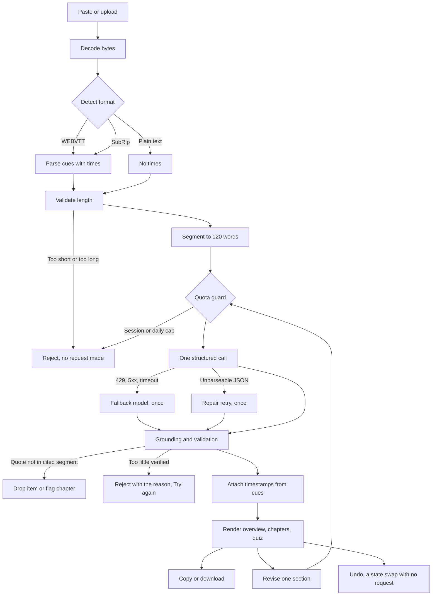

# Engineering notes

How this app is built, why I chose what I chose, what I got wrong, and where the limits
are. The research that led to the decisions is in [RESEARCH.md](RESEARCH.md); the problems
I hit are in [DEBUG_LOG.md](DEBUG_LOG.md).

## A. Technology comparison

### The short version

| | Chosen | Alternative considered | Why not the alternative |
|---|---|---|---|
| Model | Gemini `gemini-3.5-flash-lite`, free tier | Groq, free tier (`openai/gpt-oss-120b`) | Groq's free tier allows 8,000 tokens a minute. A 30-minute episode is around 8,000 tokens, so it cannot process one episode in a single call |
| Fallback | Gemini `gemini-3.1-flash-lite` | A second provider | Separate quota, same client and schema. A second provider would double the code I have to explain for no extra resilience |
| Host | Streamlit Community Cloud | Hugging Face Spaces | Streamlit is no longer a Spaces SDK, so it would need a Docker Space, and those require a paid plan |
| Transcription | Not built | Groq Whisper, OpenAI | Only Groq returns timestamps derived from the audio; OpenAI has no free tier. Out of scope for the time available |
| Output validation | Pydantic schema plus my own grounding checks | Prompt instructions alone | A prompt cannot be verified. A schema plus a quote check can be |

**Why this combination.** I needed one model that returns JSON matching a schema, accepts a
whole episode in one request, and runs with no billing account. Two numbers decided it: Groq's
free tier caps tokens per minute too low to take an episode in one call, and Gemini's
`gemini-3.8-flash` allows only 20 requests a day, which would not survive my own testing let
alone a reviewer's. The Flash Lite models have both the context and 500 requests a day each,
and running two of them gives a fallback with an independent quota for no extra complexity.
Streamlit Community Cloud was then the only free host that runs a Streamlit app, which also
made the UI framework choice for me. The cost of all this is that free-tier Gemini uses
submitted content to improve Google's products, which the app states before accepting
anything — that trade is the main thing I would revisit with a budget.

### The detail

All provider facts were read on **2026-10-12**, from official documentation except where a figure is
attributed to a signed-in provider console or to my own API tests. Free-tier limits and model
availability change often, so each documented figure links to the page it came from. Figures I could
not confirm on a provider-owned page or by calling the API myself are marked `[UNVERIFIED]`.

### A.1 LLM providers

I need one text model that reliably returns JSON matching a Pydantic schema, accepts a full
podcast transcript in one request, and runs on a free tier with no billing account.

| | **Google Gemini** (`gemini-3.8-flash`) | **Groq** (`openai/gpt-oss-120b`) | **OpenAI** (paid reference only) |
|---|---|---|---|
| JSON / structured output | JSON Schema via `response_format` on `interactions.create`; the Python SDK converts a Pydantic model with `model_json_schema()`. Only a [subset of JSON Schema](https://ai.google.dev/gemini-api/docs/structured-output) is supported and "very large or deeply nested schemas may be rejected" | `json_schema` with `strict: true` (constrained decoding) on `gpt-oss-20b`, `gpt-oss-120b`, `qwen/qwen3.8-27b`. Every property must be required, `additionalProperties` must be `false`, and [optional fields are unsupported](https://console.groq.com/docs/structured-outputs) — use `anyOf` with `null`. Streaming and tool use cannot be combined with structured outputs | Not researched — paid reference only |
| Context window | [1M tokens, 64k max output](https://ai.google.dev/gemini-api/docs/generate-content/latest-model) | [131,072 tokens, 65,536 max output](https://console.groq.com/docs/model/openai/gpt-oss-120b) | Not researched |
| Free-tier rate limits | Not in the docs — see A.2 for the figures I read from the AI Studio console | Not clearly labelled in the docs — see A.2 | No free tier for text tokens |
| Typical latency | Not published; measured figures in section E | [~500 tokens/sec](https://console.groq.com/docs/model/openai/gpt-oss-120b) throughput; end-to-end latency not published | Not researched |
| Python SDK | `google-genai`, [2.3.0 or later](https://ai.google.dev/gemini-api/docs/interactions) for the Interactions API | [`pip install groq`](https://console.groq.com/docs/quickstart), key from `GROQ_API_KEY` | `openai` |
| Free-tier data use | Google "uses the content you submit … to provide, improve, and develop" its products, "human reviewers may read, annotate, and process your API input and output", and the terms say **"Do not submit sensitive, confidential, or personal information to the Unpaid Services"** ([terms](https://ai.google.dev/gemini-api/terms)). The pricing page's free plan card reads "Content used to improve our products" | "By default, Groq does not retain customer data for inference requests"; reliability/abuse logs kept "up to 30 days" with an opt-out, and Zero Data Retention is available to all customers ([data page](https://console.groq.com/docs/your-data)). That page makes no statement either way about training on customer data `[UNVERIFIED]`. The general [website privacy policy](https://groq.com/privacy-policy) does not mention model training, but does claim a legitimate interest in using information to "improve, and develop the Services" | Not applicable |
| Cost beyond free tier | [$0.75 / $3.75 per 1M in/out](https://ai.google.dev/gemini-api/docs/pricing) through 2026-12-31, then $1.50 / $7.50 from 2027-01-01 | [$0.15 / $0.60 per 1M in/out](https://console.groq.com/docs/model/openai/gpt-oss-120b), cached input $0.075 | [gpt-5-nano $0.05 / $0.40; gpt-5-mini $0.25 / $2.00](https://developers.openai.com/api/docs/pricing) |
| Known issues | The Gemini 2.5 family is [limited to projects that already used it](https://ai.google.dev/gemini-api/docs/models); new projects are pointed at 3.5 Flash-Lite or 3.8 Flash. `minimal` thinking level errors on 3.8 Flash. Free-tier models can return a transient 503 under load (A.4). Google now recommends the Interactions API for all new projects (A.3) | Structured-output strict mode covers only a few models, and the rate-limit documentation is internally inconsistent (A.2) | No free tier |

### A.2 Free-tier rate limits

Neither provider publishes usable free-tier limits in its documentation. Gemini's
[rate limits page](https://ai.google.dev/gemini-api/docs/rate-limits) has no Free row at all and
says limits "can be viewed in Google AI Studio", so the Gemini figures below were read from the AI
Studio rate-limit console while signed in. Groq's [rate limits page](https://console.groq.com/docs/rate-limits)
shows tabs for Free and Developer plans but states the figures given are Developer base limits, and
its [model page](https://console.groq.com/docs/model/openai/gpt-oss-120b) gives different numbers
again (1K RPM / 250K TPM) for the same model.

| Model | RPM | TPM | RPD | TPD | Source |
|---|---|---|---|---|---|
| `gemini-3.8-flash` | 5 | 250K | 20 | – | AI Studio console, viewed 2026-10-12 |
| `gemini-3.5-flash-lite` | 15 | 250K | 500 | – | AI Studio console, viewed 2026-10-12 |
| `gemini-3.1-flash-lite` | 15 | 250K | 500 | – | AI Studio console, viewed 2026-10-12 |
| `gemma-4-31b` | 30 | 16K | 14.4K | – | AI Studio console, viewed 2026-10-12 |
| `openai/gpt-oss-120b` | 30 | 8K | 1K | 200K | [Groq rate limits](https://console.groq.com/docs/rate-limits) (mixed Free/Developer labelling) |
| `openai/gpt-oss-20b` | 30 | 8K | 1K | 200K | [Groq rate limits](https://console.groq.com/docs/rate-limits) (mixed Free/Developer labelling) |
| `qwen/qwen3.8-27b` | 30 | 8K | 1K | 200K | [Groq rate limits](https://console.groq.com/docs/rate-limits) (mixed Free/Developer labelling) |

A 30–40 minute episode is roughly 8K tokens, so tokens per minute is the binding constraint, not
requests. Groq's free limit of 8K TPM and Gemma's 16K TPM cannot process a normal episode in a
single call — they would force me to chunk the transcript, which breaks the one-call design and
makes cross-episode summaries harder. `gemini-3.8-flash` has the token headroom but only 20 requests
per day, shared between my own testing, the demo recording and every reviewer who opens the live
URL; that is not enough to survive assessment. The two Flash Lite models have both the token
headroom and 500 RPD. The ~8K token estimate is my own figure and I will replace it with a real
token count from the sample transcript.

Being listed in the console does not prove a model is callable: the console showed
`gemini-2.5-flash` with limits, but it returns 404 for new accounts (A.4).

### A.3 Interactions API

Google's [Interactions API](https://ai.google.dev/gemini-api/docs/interactions) is "recommended for
all new projects" and is where future models and features launch; the older `generateContent`
"remains fully supported". The structured-output docs and the REST example on the
[API key page](https://ai.google.dev/gemini-api/docs/api-key) both now use `interactions`, so I
write against `client.interactions.create()` rather than `generate_content`.

### A.4 My key tests (2026-10-12)

Tested with the `google-genai` Python SDK. Both provider keys authenticate: `models.list` succeeded
on Gemini and on Groq.

| Model | Result |
|---|---|
| `gemini-3.8-flash` | `generate_content` OK |
| `gemini-3.5-flash-lite` | OK |
| `gemini-3.1-flash-lite` | First attempt 503 UNAVAILABLE, "This model is currently experiencing high demand… try again later"; OK on retry after ~1 minute |
| `gemini-2.5-flash` | 404, "no longer available to new users, use gemini-3.8-flash" |

The 404 matches the model page above, so I must only call models available to new accounts. The 503
is the more useful result: a free-tier model can be temporarily overloaded even with a valid key and
quota remaining, and it recovered on its own within a minute. That is a transient failure, not an
auth or quota failure, and it has to be handled differently from both — it argues for retry with
backoff plus a fallback model on a separate quota.

Since 2026-05-28, "all new API keys created in Google AI Studio are automatically created as auth
keys" ([API key page](https://ai.google.dev/gemini-api/docs/api-key)); these are the keys that print
with an `AQ.` prefix. That page documents the key *type* but not the string format. Developer-forum
reports attribute `401 UNAUTHENTICATED / ACCESS_TOKEN_TYPE_UNSUPPORTED` failures to older clients
that expect the previous `AIza` format `[UNVERIFIED — forum reports, not official docs]`. My key
works through `google-genai`, which is consistent with those reports.

### A.5 Hosting

I need a host that runs a Streamlit app on a free tier with no billing account, keeps one API key
server-side, and stays reachable for reviewers for at least two weeks.

| | **Streamlit Community Cloud** | **Hugging Face Spaces** |
|---|---|---|
| Runs Streamlit? | Yes, it is the first-party host | **Not as a native SDK.** The [config reference](https://huggingface.co/docs/hub/spaces-config-reference) says `sdk` "Can be either `gradio`, `docker`, or `static`" and `sdk_version` is "the version of Gradio to use". A Streamlit app would have to be a Docker Space |
| Free tier | [690MB–2.7GB memory, 0.078–2 CPU cores, up to 50GB storage](https://docs.streamlit.io/deploy/streamlit-community-cloud/manage-your-app), listed as of February 2024 and "may change at any time without notice" | CPU Basic is [2 vCPU, 16GB RAM, 50GB non-persistent disk at no hourly cost](https://huggingface.co/docs/hub/spaces-overview) — but "Gradio and Docker Spaces run on compute and require a paid plan to create: PRO for personal accounts". Only static Spaces are free for everyone |
| Sleep / wake | Sleeps after [12 hours with no traffic](https://docs.streamlit.io/deploy/streamlit-community-cloud/manage-your-app); anyone with view access wakes it with a "Yes, get this app back up!" button | On free hardware a Space will ["go to sleep" and stop executing after a period of time if unused](https://huggingface.co/docs/hub/spaces-overview); the period is not given `[UNVERIFIED]` |
| Secrets | Saved in the app's settings and read with `st.secrets`; `.streamlit/secrets.toml` is local-only and ["should never be committed to your repository"](https://docs.streamlit.io/deploy/streamlit-community-cloud/deploy-your-app/secrets-management) | Settings-page secrets, private and unreadable after being set, exposed to the app as environment variables; a secrets scanner warns on hard-coded values ([overview](https://huggingface.co/docs/hub/spaces-overview)) |
| Repo visibility | App visibility follows the repo, and ["You are only allowed one private app at a time"](https://docs.streamlit.io/deploy/streamlit-community-cloud/share-your-app). My repo is public, so this does not bind me | Public, protected or private; protected needs a paid plan |
| Upload limit | Streamlit's own [`maxUploadSize` default is 200](https://docs.streamlit.io/develop/api-reference/configuration/config.toml) MB | Same Streamlit setting would apply inside a Docker Space; no Spaces-specific request limit documented `[UNVERIFIED]` |
| Logs | "Manage app" → Cloud logs, downloadable; rebooting also clears the app's memory | Not covered on the overview page `[UNVERIFIED]` |

Hugging Face Spaces is not a free option for this app. Streamlit is no longer a Spaces SDK, so I
would have to build a Docker Space, and creating a Docker Space requires a PRO plan on a personal
account. That conflicts with free-tier-only, so Streamlit Community Cloud is the only one of the two
I can actually deploy on. Because Spaces is ruled out on cost, I did not chase the three
unconfirmed Spaces details above any further.

Note a documentation inconsistency: Hugging Face still publishes a
[Streamlit Spaces page](https://huggingface.co/docs/hub/spaces-sdks-streamlit) describing
`sdk: streamlit`, but it cites Streamlit 1.25.0 and links to retired Streamlit docs paths, and the
current config reference does not list `streamlit` as a valid SDK. I treat the config reference as
authoritative.

### A.6 Transcription (not built)

Audio upload is out of scope for this build. This is the comparison I would start from if I added
it.

| | **Groq Whisper** | **Gemini audio input** | **OpenAI transcription** |
|---|---|---|---|
| File limits | [25 MB free tier, 100 MB dev tier](https://console.groq.com/docs/speech-to-text); larger files via a `url` parameter instead of upload. Minimum billed length 10 seconds | [20 MB total inline request size](https://ai.google.dev/gemini-api/docs/audio) including prompt and files, or the Files API for larger; up to 9.5 hours per prompt | [25 MB](https://developers.openai.com/api/docs/guides/speech-to-text); larger files must be compressed or split into 25 MB chunks |
| Formats | flac, mp3, mp4, mpeg, mpga, m4a, ogg, wav, webm | WAV, MP3, AIFF, AAC, OGG, FLAC, MPEG, M4A, L16, Opus, ALAW, MULAW, WebM | mp3, mp4, mpeg, mpga, m4a, wav, webm |
| Timestamps | API-derived: `response_format=verbose_json` with `timestamp_granularities[]` of `word` and/or `segment` (segment is the default) | **No documented structured segment field** — timestamps come from the model's text output, or from a response schema you define yourself | API-derived, but `timestamp_granularities[]` is supported only on `whisper-1`, and the page documents `word` granularity without explicitly documenting `segment` `[UNVERIFIED]`. `gpt-4o-transcribe-diarize` returns segments with `start`/`end` via `diarized_json` |
| Cost | `whisper-large-v3` $0.111/hour, `whisper-large-v3-turbo` $0.04/hour | Audio counts as input tokens at [32 tokens per second](https://ai.google.dev/gemini-api/docs/audio) (1,920/minute), so it draws on the same free-tier token quota | [whisper-1 $0.006/min, gpt-transcribe $0.0045/min](https://developers.openai.com/api/docs/pricing); no free tier listed |

OpenAI's transcription endpoint is a credible option on capability — its limits and formats are
close to Groq's — but it has no free tier, so the free-tiers-only rule excludes it before quality
or latency enters the discussion. That leaves Groq Whisper as the only option returning timestamps
derived from the transcription itself. Gemini would have the model write the times, which our
grounding rule forbids. So adding audio means adding a second provider: Groq for segments, Gemini
for text. The 25 MB free-tier cap is the other constraint: at a
typical 128 kbps podcast bitrate that is roughly 26 minutes of audio by my own arithmetic, so a
40-minute episode would exceed it and need the `url` parameter.

Groq's speech-to-text page also contradicts itself: its Python example comment says to set
`response_format` to `json` for timestamps while the parameter table requires `verbose_json`. The
table is the one to follow.

### A.7 Sources
- [Gemini models](https://ai.google.dev/gemini-api/docs/models) — model IDs; 2.5 family restricted to prior users, which explains my 404.
- [Gemini 3.8 Flash](https://ai.google.dev/gemini-api/docs/generate-content/latest-model) — 1M context, 64k output.
- [Gemini rate limits](https://ai.google.dev/gemini-api/docs/rate-limits) — tier definitions; free-tier numbers live in AI Studio, not the docs.
- [Gemini pricing](https://ai.google.dev/gemini-api/docs/pricing) — free tier covers Flash; paid rates and the 2026-12-31 cutoff.
- [Gemini structured output](https://ai.google.dev/gemini-api/docs/structured-output) — Pydantic to JSON Schema, and only a subset is supported.
- [Interactions API](https://ai.google.dev/gemini-api/docs/interactions) — recommended entry point; `generateContent` is legacy.
- [Gemini terms](https://ai.google.dev/gemini-api/terms) — unpaid-tier inputs improve Google products and may be read by humans.
- [Gemini API keys](https://ai.google.dev/gemini-api/docs/api-key) — auth keys since 2026-05-28; never ship keys client-side.
- [Gemini audio](https://ai.google.dev/gemini-api/docs/audio) — 20 MB inline, 32 tokens/second, no segment timestamp field.
- [Groq gpt-oss-120b](https://console.groq.com/docs/model/openai/gpt-oss-120b) — price, context, and the only published throughput figure.
- [Groq rate limits](https://console.groq.com/docs/rate-limits) — per-model limits and the Free/Developer inconsistency.
- [Groq structured outputs](https://console.groq.com/docs/structured-outputs) — strict mode models; optional fields unsupported.
- [Your data in GroqCloud](https://console.groq.com/docs/your-data) — no retention by default, 30-day abuse logs, ZDR.
- [Groq speech-to-text](https://console.groq.com/docs/speech-to-text) — 25 MB free cap and `verbose_json` segment timestamps.
- [Groq models](https://console.groq.com/docs/models), [quickstart](https://console.groq.com/docs/quickstart), [privacy policy](https://groq.com/privacy-policy) — context windows, SDK name and key variable, and privacy wording I could not reconcile with the data page.
- [OpenAI pricing](https://developers.openai.com/api/docs/pricing) — paid baseline; no free text-token tier, and transcription from $0.0045/min.
- [OpenAI speech-to-text](https://developers.openai.com/api/docs/guides/speech-to-text) — 25 MB cap, formats, and that `timestamp_granularities[]` is `whisper-1` only.
- [OWASP API Security Project](https://api-security.owasp.org/) and [API4:2023 Unrestricted Resource Consumption](https://api-security.owasp.org/editions/2023/en/0xa4-unrestricted-resource-consumption) — rate limiting, payload size caps and spending limits, the brief's own reference.
- [Edison Research, UK Podcast Consumer 2025](https://ssrs.com/insights/the-uk-podcast-consumer-2025/) — 71% ever, 51% last month, 33% last week among UK adults 16+, published 7 August 2025. Edison Research now publishes under SSRS; the old edisonresearch.com URL redirects there.
- [Streamlit: manage your app](https://docs.streamlit.io/deploy/streamlit-community-cloud/manage-your-app) — resource ceilings, 12-hour sleep, logs.
- [Streamlit secrets](https://docs.streamlit.io/deploy/streamlit-community-cloud/deploy-your-app/secrets-management) — `st.secrets`; never commit `secrets.toml`.
- [Streamlit share your app](https://docs.streamlit.io/deploy/streamlit-community-cloud/share-your-app) — app visibility follows the repo.
- [Streamlit config.toml](https://docs.streamlit.io/develop/api-reference/configuration/config.toml) — `maxUploadSize` defaults to 200 MB.
- [Spaces overview](https://huggingface.co/docs/hub/spaces-overview) — CPU Basic specs, secrets, sleep, and the paid-plan requirement.
- [Spaces config reference](https://huggingface.co/docs/hub/spaces-config-reference) — `sdk` accepts only `gradio`, `docker`, `static`.
- [OWASP Top 10 for LLM Applications](https://genai.owasp.org/llm-top-10/) — the 2025 entries I mapped mitigations against.

## B. Architecture

### Processing stages

Six stages. Each is a plain function over data, and only one of them touches a network.

1. **Read the input.** An upload's extension is re-checked, then bytes are decoded looking
   for a UTF-16 byte-order mark, then UTF-8, then cp1252.
2. **Detect the format from the content**, not the extension, because a pasted transcript
   has no extension and I wanted one rule for both paths.
3. **Validate** — 250 words minimum, 150,000 characters maximum — before any request, so
   input that cannot produce a result costs nothing.
4. **Segment.** Cues merge to a 120-word target, keeping the first cue's start and the last
   cue's end; plain text packs the same way with no times. Segments are numbered `S001`,
   `S002`, and those numbers are the only thing the model may cite.
5. **One model call** — segments, task and schema out, one structured response back.
6. **Ground, then render.** Cited ids must exist, quotes must appear in the segment they
   cite, chapters must start at increasing segments. Timestamps are attached here by my
   code, from the parsed cues.

Revision reuses stages 5 and 6 for one section. The quota guard sits in front of stage 5
and is the only thing that can stop a request being made.

### What each file does

`app.py` is the only file that imports Streamlit, which is why the suite runs in about ten
seconds with no key and no browser.

| File | What it does |
|---|---|
| `app.py` | Page layout and session state; calls into the package |
| `config.py` | Limits, model names, timeout and retry settings in one place |
| `messages.py` | Every message a user can be shown when something goes wrong |
| `parsing.py` | Decode, detect format, extract cues, validate length |
| `segments.py` | Build numbered segments from cues or text; format timestamps |
| `models.py` | The result schema, which is also the JSON Schema sent to the model |
| `prompts.py` | System instruction and the two prompt templates |
| `llm.py` | The only file that talks to the provider: call, classify, fall back, repair |
| `grounding.py` | Verify citations, drop or flag failures, attach timestamps |
| `quota.py` | Per-session and process-wide request counters |
| `render.py` | Display strings, with no Streamlit import |
| `export.py` | Markdown and JSON payloads for copy and download |
| `sample.py` | Load the committed example episode and its pre-generated result |
| `text.py` | A pluralisation helper, shared so counts read correctly |

## C. Debugging example

The problem I spent longest on was an interaction bug: after typing a transcript, the first
click on **Generate** did nothing and a second was needed. The suite was green throughout,
because the app tests set the text in one server round trip and pressed the button in
another — two clicks, written down as the expectation. A free-standing text area only sends
its value when it loses focus, so the click that blurred it was spent committing the text.
Moving the input into a form fixed it, at the cost of the live character counter.

Full account, plus four other issues, in [DEBUG_LOG.md](DEBUG_LOG.md).

## D. Reliability and limitations

### Incorrect outputs

Every takeaway, chapter and quiz answer must cite a numbered segment and quote text from
it. After the reply I check the segment exists, the quote appears in it after normalising
punctuation style and whitespace, and chapter starts increase. A failing takeaway or
question is dropped; a failing chapter is kept but marked unverified and shown without a
timestamp, because removing it would leave a hole in the navigation. The interface reports
real counts — "kept 4 of 5 takeaways" — rather than hiding what was removed.

Timestamps cannot be wrong, because the model never produces one: chapters cite a segment
and my code reads that segment's start time from the parsed cues. There is no time field in
the schema. The quote match is deliberately not fuzzy — edit distance would start accepting
paraphrase, which is what the check exists to catch.

### Failed requests

The SDK retries transient failures itself; I bound that to two attempts with a two-second
ceiling, because its defaults allow five attempts with delays growing to a minute. After
that, a per-minute limit, spent quota, 5xx, timeout or unrecognised connection error moves
to the second model once; a rejected or missing key is reported as configuration with no
retry, since retrying cannot help; unparseable output gets one repair retry and then a
clear error with no partial result. Nothing retries more than once at any layer, and any
failure that leaves the example episode usable says so, because that path needs no request.

### Excessive processing time

The timeout is 45 seconds. A transient failure hands over in about two seconds, so the
realistic worst case is two timeouts in a row, roughly 90 seconds, and the repair retry is
skipped if 60 seconds have already gone. Elapsed time is shown on completion and logged.

### Unexpected inputs

Rejected before any request: empty, under 250 words, over 150,000 characters, wrong file
type, undecodable. A subtitle file with more than a fifth of its cues unreadable is
rejected as damaged; one with no readable cues but enough prose is treated as plain text and
the interface says so. Transcripts and revision instructions are both untrusted — they sit
inside named delimiters labelled as data, the behavioural rules live in a separate system
instruction that transcript text cannot reach, and instructions are capped at 300 characters
with delimiter-like lines defused. The real defence is grounding: injected text cannot
produce a quote that exists in a cited segment.

### Limitations I know about

- **The limits slow a visitor down rather than bounding them.** The app does not identify
  visitors, so the 10-generation limit is per browser session and a new session starts a
  fresh allowance. The process-wide counter of 400 requests a day is the real bound. It
  lives in the running process's memory, and the host sleeps the app after twelve hours and
  restarts it on redeploy, so it resets on both. I watched this in production: after a reboot
  the counter read 399 of 400 rather than continuing. It is a guard against accidental
  overuse, not a durable limit — the provider refusing requests is the real backstop.
- **Latency varies about threefold on the same input.** See section E.
- **Quote matching forgives punctuation style but not punctuation choice.** A model writing
  "the timing - not the recipe" where the transcript says "the timing, not the recipe" fails
  verification and the item is dropped. I would rather drop a good item than accept a bad
  one, but I have not measured how often this happens.
- **The free tier uses your input.** Google's unpaid-tier terms say submitted content is
  used to improve their products and may be read by human reviewers. The app says so before
  accepting anything. This is the clearest cost of running without a billing account.
- **The app sleeps after twelve hours** without traffic; any visitor can wake it, but that
  first load is slow.
- **Audio is not supported** — reasons in [RESEARCH.md](RESEARCH.md).

## E. Cost and maintenance

### What one episode costs

Measured on the committed example episode, a 2,370-character transcript:

| Part of the request | Characters | Tokens at 4 chars/token |
|---|---|---|
| Prompt, including the segmented transcript | 2,204 | ~550 |
| JSON Schema sent with the request | 2,615 | ~650 |
| Generated result | 5,434 | ~1,360 |
| **One generation** | | **~2,560** |

The schema is a fixed ~650-token overhead on every call — a quarter of a short request,
which is more than I expected. Assumption: four characters per token for English, a rule of
thumb rather than a measurement; I am not using the provider's tokeniser. At the
150,000-character limit a transcript is roughly 37,500 input tokens, about 18% of the
250,000-token-per-minute free allowance once an 8,000-token output budget is added, so one
maximum-size request fits comfortably.

### Free-tier headroom and paid cost

The free tier gives 500 requests a day per model and I use two, so about 1,000 are
available. My own cap is 400 a day with 10 per session, so normal use cannot exhaust the
allowance. At ~2,560 tokens a generation that is roughly a million tokens a day — requests,
not tokens, are the binding constraint.

On paid pricing, `gemini-3.5-flash-lite` is **$0.30 per million input tokens and $2.50 per
million output** ([pricing](https://ai.google.dev/gemini-api/docs/pricing), checked
2026-10-13; no introductory rate listed for this model). One example episode is ~1,200
input and ~1,360 output tokens, so about **$0.0038**; a thousand episodes about **$3.80**; a
maximum-size transcript about **$0.015** each. Arithmetic from measured character counts and
published prices, not observed billing.

### Latency

| Input | Measured |
|---|---|
| 387 characters, a smoke test during setup | 5.3 s |
| 1,657 characters / 280 words, plain text, on the deployed app | 5.2 s |
| 2,370 characters / 325 spoken words, the example episode with cues | 8.8 s |
| 291 words, plain text, 3 segments, first request after a reboot (2026-10-13) | 44.8 s |
| 291 words, plain text, 3 segments, a later session (2026-10-13) | 15.6 s |
| 147,987 characters, plain text, 249 segments (2026-10-13) | 38.1 s |

**The spread matters more than the size.** The same 291-word paste took 44.8 s in one session
and 15.6 s in another on the same build, and the slower one was the first request after a
reboot. The near-limit file, 249 segments against 3, came back in 38.1 s — faster than the
slowest short run. At this scale latency follows provider load and output length, not how
much transcript goes in.

**I kept the 150,000-character cap.** Lowering it would not remove the risk, because the
slowest run was a short input. A call that does reach the 45-second timeout is treated as
transient: the fallback model is tried once, and if that also times out the user is told the
request took longer than 45 seconds and that a shorter transcript will be faster. Raising the
timeout is the worse option, because it also doubles the worst case when a model is
unavailable and the fallback is tried.

The near-limit file was the example transcript's text repeated 83 times, so it measures size
handling and latency, not output quality: 4 of 4 takeaways and 3 of 3 chapters were kept, and
2 of 7 quiz questions were dropped as unverifiable. Its request count is not isolated, because
a second run overlapped in another browser tab.

### Dependencies and configuration

Three pinned runtime dependencies: `streamlit` 1.65.0, `google-genai` 2.29.0 and `pydantic`
2.14.1. `pytest` is a development dependency and is not installed in production, because the
host installs from `requirements.txt` and that file does not list it. Keeping the list short
was deliberate: fewer libraries means fewer things I cannot explain.

Configuration is one file, `config.py` — limits, model names, timeout, retry policy. The
only secret is the API key, from Streamlit's secrets store in production and a git-ignored
file locally. It is never logged, never shown in the interface, never committed; what is
committed is an example file with a placeholder.

### Maintenance risks

- **Models get retired.** This happened mid-project: `gemini-2.5-flash` stopped being
  available to new projects while I was choosing between models. Model names therefore sit
  in `config.py` rather than at the call site, so switching one is a one-line edit, a push
  and a reboot. A 404 from the primary also falls through to the second model on its own.
- **Redeploys need a reboot when package files change.** The host can pick up a new entry
  point while keeping an already-imported module in memory, which crashed the live app once.
  See [DEBUG_LOG.md](DEBUG_LOG.md) and the README.
- **The committed example result can go stale.** A test loads it and runs it through the
  current validator, so if the prompts or schema change in a way that invalidates it, the
  suite fails and tells me to regenerate it with `tools/generate_sample.py`.
- **Free-tier limits are not published.** Neither provider documents them on a public page;
  the figures in section A came from a signed-in console. They can change without notice,
  and my own caps would need revisiting if they did.

## Next steps

The three things I would do next, in the order I would do them. All three come from
limitations I hit rather than features I imagined.

### 1. Make the request limit real, with a shared store

**Why first.** It is the only limitation that can cost someone money. The counters live in
the running process's memory, so they reset whenever the host sleeps or restarts the app,
and they would count separately if the platform ever ran more than one process. I watched a
reboot reset the count from 399 to 400 in production. Everything else on this list is a
quality improvement; this one is the difference between a documented guard and an actual
limit.

**What I would do.** Move the daily counter into a small external store — a free-tier
key-value service, or a single row in a hosted database — keyed by the UTC date, read and
incremented atomically. Keep the in-memory counter as a fast local check in front of it so
the common case still costs nothing.

**Expected impact.** The daily cap becomes enforceable rather than advisory, and survives
restarts. It also makes the per-session limit meaningful, since a visitor could otherwise
reset their own allowance by opening a new session. The cost is one more dependency and one
more thing that can fail, so the store has to fail open — refusing to generate because a
counter is unreachable would be worse than the problem it solves.

### 2. Measure quote-matching failures, then decide whether to loosen the rule

**Why second.** The quote check is what makes the output trustworthy, and I have no idea how
often it rejects a legitimate item. I know it forgives punctuation style but not punctuation
choice: a model writing a dash where the transcript has a comma loses that item. In the
generations I have run, nothing was dropped for this reason, but three generations is not
evidence.

**What I would do.** Record, for every dropped item, the quote and the segment it cited, and
whether a looser comparison would have accepted it — punctuation stripped entirely, say, or
a word-sequence match that ignores all non-alphanumerics. Run that over fifty generations
and look at the disagreements by hand. Only then decide whether to loosen, because the
decision needs data rather than instinct.

**Expected impact.** Either confidence that the strict rule costs nothing, or a measured
case for relaxing it. Both are better than the current position, which is a guess with a
plausible argument attached. The risk of loosening without measuring is accepting
paraphrase, which would quietly undermine the one claim the app makes.

### 3. Chunk long transcripts instead of refusing them

**Why third.** It is the biggest product limitation but the least urgent, because the
current cap of 150,000 characters covers around three hours of speech and almost no episode
exceeds it. It matters because I never measured latency near that cap, so I do not actually
know that a maximum-size transcript completes inside the 45-second timeout — the limit is
set by arithmetic, not observation.

**What I would do.** First measure it, which costs one request and would tell me whether
there is a problem at all. If a full-size transcript does approach the timeout, split the
transcript into overlapping windows, generate chapters and quiz items per window, then merge
by segment order and deduplicate. The overview would need a second pass over the per-window
summaries. Grounding stays unchanged, because segment ids remain global.

**Expected impact.** Removes the input ceiling and makes latency predictable, since each
window is a known size. The cost is real: several requests per episode instead of one, which
interacts badly with the free-tier daily limit, and a merge step that can produce chapters
that read oddly at window boundaries. That is why it is third — the benefit is narrow and
the complexity is not.
